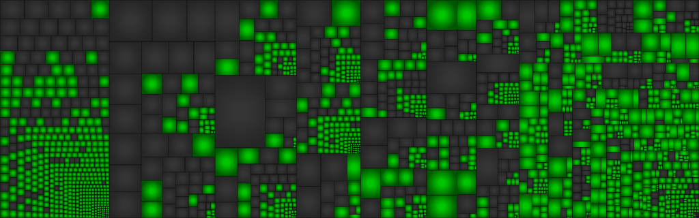

# Hot Wheels Turbo Racing (N64, USA): decompilación

[English](README.md) | **Español** | [Português (Brasil)](README.pt-BR.md)

[](https://bytematch.dev/orymizak/hwtr-decomp)

[](https://bytematch.dev/orymizak/hwtr-decomp)

Reconstrucción en C del código de *Hot Wheels Turbo Racing* para Nintendo 64. El objetivo es que el
código compile a una ROM idéntica byte a byte a la original.

**Este repositorio no contiene la ROM, assets ni código del juego ya compilado.** Necesitas tu propia
copia legal de la ROM: de ella se extrae todo lo demás en tu equipo. No compartas la ROM, `assets/`,
`asm/` ni `build/`.

## Estado

La ROM se reconstruye idéntica; el código restante sigue en ensamblador generado.

<!-- progress -->
| Zona | Funciones | Bytes de código | Avance |
|---|---|---|---|
| total | 1850/1915 | 520160/554576 | 93.79 % |
| juego | 1366/1373 | 422640/446896 | 94.57 % |
| audio | 187/188 | 31824/32608 | 97.60 % |
| sistema | 87/87 | 10064/10064 | 100.00 % |
| libultra | 210/242 | 55632/60640 | 91.74 % |
| libc | 0/25 | 0/4368 | 0.00 % |
<!-- /progress -->

`make progress` actualiza esta tabla.

- **Compilador:** un GCC 2.7.2 compatible con KMC reproduce exactamente las funciones probadas. Las opciones
  de optimización varían por archivo (`-O2`, `-O3` en la mayor parte de libultra, `-O0` en algunos sitios).
- **Librerías:** libultra (SDK 2.0K/L), libc y un driver de audio están separados del juego en el mapa de la ROM.
  Las funciones de libultra y libaudio se identificaron compilando [ultralib](https://github.com/decompals/ultralib)
  y comparando. ultralib no está incluida: `make toolchain` la clona en `tools/ultralib` y el código C
  usa sus cabeceras del SDK (`PR/ultratypes.h`, …).
- **.rodata:** empieza en la ROM en `0x9F3B0` y está dividida por unidad en `asm/data/`. `tools/cc.py`
  hace que el código C use esos símbolos en lugar de emitir duplicados.
- **Por hacer:** el resto del código del juego y el driver de audio.

## ROM requerida

| | |
|---|---|
| Archivo | `baserom.z64` (big-endian) |
| Tamaño | 12.582.912 bytes |
| SHA-1 | `94913a07e49005ffd43dfdfa16ff5862bdb93748` |
| ID interno | `NHWE` |

## Requisitos

- Python 3 con las dependencias de `requirements.txt`, por ejemplo en un entorno virtual
- GNU Make y `curl`
- Binutils MIPS:
  - macOS: `brew install mips-linux-gnu-binutils`
  - Debian/Ubuntu: `apt install binutils-mips-linux-gnu`
- GCC 2.7.2 para MIPS, binutils 2.6 y las cabeceras de ultralib, que instala `make toolchain`

En Mac con Apple Silicon, el compilador es un binario x86_64 y necesita Rosetta:
`softwareupdate --install-rosetta`.

## Compilar

```sh
python3 -m venv .venv && source .venv/bin/activate
pip install -r requirements.txt
cp /ruta/a/tu/rom.z64 baserom.z64
make toolchain
make split
make
```

`make` construye `build/hotwheelsturbo.z64` y comprueba su SHA-1.

`python3 main.py` compila, comprueba la ROM y cada función en C, y muestra el avance. No es el juego.

Para extraer y descomprimir los 201 archivos del juego en `assets/files/`:

```sh
make extract
```

## Estructura

| Ruta | Contenido |
|---|---|
| `src/` | código C reconstruido |
| `include/` | cabeceras y macros de ensamblador |
| `hotwheelsturbo.yaml` | mapa de la ROM para [splat](https://github.com/ethteck/splat) |
| `symbol_addrs.txt` | símbolos identificados |
| `tools/extract_files.py` | extractor y descompresor de archivos |
| `tools/match/` | herramientas de matching (ver su README) |

`make split` genera a partir de tu ROM `asm/`, `assets/` y el script de enlazado. Nada de eso se versiona.

## Licencia

Las herramientas, scripts de compilación y documentación propios de este repositorio se publican con la [licencia MIT](LICENSE).
El código descompilado se ofrece con fines de preservación e investigación; el juego y el SDK de Nintendo 64 siguen siendo de sus respectivos dueños.
No se incluye la ROM ni archivos del juego: necesitas tu propia copia legal para compilarlo.
