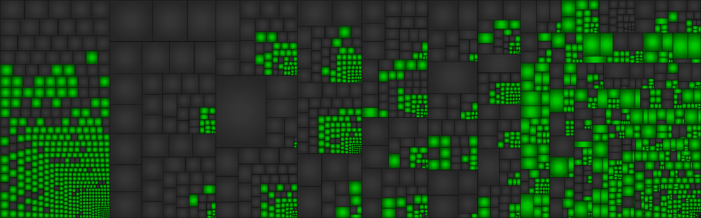

# Hot Wheels Turbo Racing (N64, USA): decompilation

**English** | [Español](README.es.md)

[](https://bytematch.dev/orymizak/hwtr-decomp)

[](https://bytematch.dev/orymizak/hwtr-decomp)

A C reconstruction of the code of *Hot Wheels Turbo Racing* for the Nintendo 64. The goal is for the
code to compile into a ROM that is byte-for-byte identical to the original.

**This repository does not contain the ROM, game assets or any compiled game code.** You need your own
legally obtained copy of the ROM: everything else is extracted from it on your machine. Do not share the
ROM, `assets/`, `asm/` or `build/`.

## Required ROM

| | |
|---|---|
| File | `baserom.z64` (big-endian) |
| Size | 12,582,912 bytes |
| SHA-1 | `94913a07e49005ffd43dfdfa16ff5862bdb93748` |
| Internal ID | `NHWE` |

## Requirements

- Python 3 with the dependencies in `requirements.txt`, e.g. in a virtual environment
- GNU Make and `curl`
- MIPS binutils:
  - macOS: `brew install mips-linux-gnu-binutils`
  - Debian/Ubuntu: `apt install binutils-mips-linux-gnu`
- GCC 2.7.2 for MIPS and binutils 2.6, installed by `make toolchain`

On Apple Silicon Macs the compiler is an x86_64 binary and needs Rosetta:
`softwareupdate --install-rosetta`.

## Building

```sh
python3 -m venv .venv && source .venv/bin/activate
pip install -r requirements.txt
cp /path/to/your/rom.z64 baserom.z64
make toolchain
make split
make
```

`make` builds `build/hotwheelsturbo.z64` and checks its SHA-1.

`python3 main.py` builds, checks the ROM and every C function, and prints the progress. It is not the game.

To extract and decompress the game's 201 files into `assets/files/`:

```sh
make extract
```

## Layout

| Path | Contents |
|---|---|
| `src/` | reconstructed C code |
| `include/` | headers and assembler macros |
| `hotwheelsturbo.yaml` | ROM map for [splat](https://github.com/ethteck/splat) |
| `symbol_addrs.txt` | identified symbols |
| `tools/extract_files.py` | file extractor and decompressor |
| `tools/match/` | matching tools (see its README) |

`make split` generates `asm/`, `assets/` and the linker script from your ROM. None of that is versioned.

## Status

The ROM rebuilds identically; the remaining code is still generated assembly.

<!-- progress -->
| Area | Functions | Code bytes | Progress |
|---|---|---|---|
| total | 1332/1917 | 182344/554576 | 32.88% |
| game | 914/1373 | 109552/446896 | 24.51% |
| audio | 142/188 | 13128/32608 | 40.26% |
| system | 66/87 | 4608/10064 | 45.79% |
| libultra | 210/244 | 55056/60640 | 90.79% |
| libc | 0/25 | 0/4368 | 0.00% |
<!-- /progress -->

`make progress` updates this table.

- **Compiler:** a KMC-compatible GCC 2.7.2 reproduces the tested functions exactly. Optimization flags vary
  per file (`-O2`, `-O3` for most of libultra, `-O0` in a few places).
- **Libraries:** libultra (SDK 2.0K/L), libc and an audio driver are separated from the game in the ROM map.
  libultra and libaudio functions were identified by compiling [ultralib](https://github.com/decompals/ultralib)
  and comparing; ultralib is used as a reference only and is not included.
- **.rodata:** starts at ROM offset `0x9F3B0` and is split per unit in `asm/data/`. `tools/cc.py` makes the C
  code use those symbols instead of emitting duplicates.
- **To do:** the rest of the game code and the audio driver.

## License

The original tooling, build scripts and documentation in this repository are released under the [MIT License](LICENSE).
Decompiled code is provided for preservation and research purposes; the game and the Nintendo 64 SDK remain the property of their respective owners.
No ROM or game assets are included: you need your own legally obtained copy of the game to build it.
