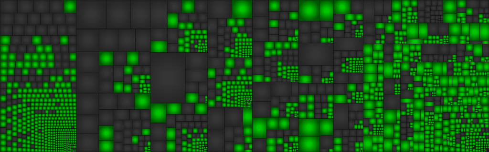

# Hot Wheels Turbo Racing (N64, EUA): descompilação

[English](README.md) | [Español](README.es.md) | **Português (Brasil)**

[](https://bytematch.dev/orymizak/hwtr-decomp)

[](https://bytematch.dev/orymizak/hwtr-decomp)

Uma reconstrução em C do código de *Hot Wheels Turbo Racing* para Nintendo 64. O objetivo é que o
código compile em uma ROM idêntica byte a byte à original.

**Este repositório não contém a ROM, assets nem código compilado do jogo.** Você precisa da sua própria
cópia legalmente obtida da ROM: todo o restante é extraído dela na sua máquina. Não compartilhe a
ROM, `assets/`, `asm/` ou `build/`.

## Status

A ROM é reconstruída de forma idêntica; o código restante ainda está em assembly gerado.

<!-- progress -->
| Área | Funções | Bytes de código | Progresso |
|---|---|---|---|
| total | 1850/1915 | 520160/554576 | 93.79% |
| jogo | 1366/1373 | 422640/446896 | 94.57% |
| audio | 187/188 | 31824/32608 | 97.60% |
| sistema | 87/87 | 10064/10064 | 100.00% |
| libultra | 210/242 | 55632/60640 | 91.74% |
| libc | 0/25 | 0/4368 | 0.00% |
<!-- /progress -->

`make progress` atualiza esta tabela.

- **Compilador:** um GCC 2.7.2 compatível com KMC reproduz exatamente as funções testadas. As flags de
  otimização variam por arquivo (`-O2`, `-O3` na maior parte da libultra, `-O0` em alguns trechos).
- **Bibliotecas:** libultra (SDK 2.0K/L), libc e um driver de áudio ficam separados do jogo no mapa da ROM.
  As funções da libultra e da libaudio foram identificadas compilando [ultralib](https://github.com/decompals/ultralib)
  e comparando. A ultralib não está incluída: `make toolchain` a clona em `tools/ultralib` e o código C
  usa seus cabeçalhos do SDK (`PR/ultratypes.h`, …).
- **.rodata:** começa no offset `0x9F3B0` da ROM e está dividida por unidade em `asm/data/`. `tools/cc.py`
  faz o código C usar esses símbolos em vez de emitir duplicatas.
- **A fazer:** o restante do código do jogo e do driver de áudio.

## ROM necessária

| | |
|---|---|
| Arquivo | `baserom.z64` (big-endian) |
| Tamanho | 12.582.912 bytes |
| SHA-1 | `94913a07e49005ffd43dfdfa16ff5862bdb93748` |
| ID interno | `NHWE` |

## Requisitos

- Python 3 com as dependências de `requirements.txt`, por exemplo em um ambiente virtual
- GNU Make e `curl`
- Binutils MIPS:
  - macOS: `brew install mips-linux-gnu-binutils`
  - Debian/Ubuntu: `apt install binutils-mips-linux-gnu`
- GCC 2.7.2 para MIPS, binutils 2.6 e os cabeçalhos da ultralib, instalados por `make toolchain`

Em Macs com Apple Silicon, o compilador é um binário x86_64 e precisa do Rosetta:
`softwareupdate --install-rosetta`.

## Compilação

```sh
python3 -m venv .venv && source .venv/bin/activate
pip install -r requirements.txt
cp /caminho/para/sua/rom.z64 baserom.z64
make toolchain
make split
make
```

`make` gera `build/hotwheelsturbo.z64` e verifica seu SHA-1.

`python3 main.py` compila, verifica a ROM e cada função em C, e exibe o progresso. Não é o jogo.

Para extrair e descompactar os 201 arquivos do jogo em `assets/files/`:

```sh
make extract
```

## Estrutura

| Caminho | Conteúdo |
|---|---|
| `src/` | código C reconstruído |
| `include/` | cabeçalhos e macros de assembly |
| `hotwheelsturbo.yaml` | mapa da ROM para [splat](https://github.com/ethteck/splat) |
| `symbol_addrs.txt` | símbolos identificados |
| `tools/extract_files.py` | extrator e descompactador de arquivos |
| `tools/match/` | ferramentas de matching (veja seu README) |

`make split` gera `asm/`, `assets/` e o script de linker a partir da sua ROM. Nada disso é versionado.

## Licença

As ferramentas originais, scripts de compilação e documentação deste repositório são distribuídos sob a [Licença MIT](LICENSE).
O código descompilado é fornecido para fins de preservação e pesquisa; o jogo e o SDK do Nintendo 64 permanecem propriedade de seus respectivos donos.
Nenhuma ROM ou asset do jogo está incluído: você precisa da sua própria cópia legalmente obtida do jogo para compilá-lo.
